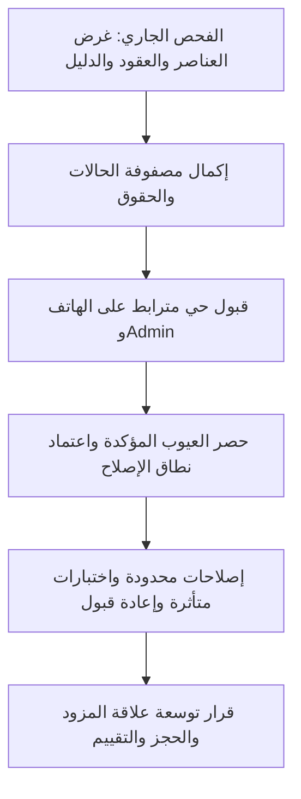

# أعرست — قرارات وأولويات مبنية على الفحص الجاري

**Checkpoint، وليس تقرير قبول شامل أو إذن تنفيذ.** المصدر:14eccb50c6b2e050b044c7b00ac38a7e64f5164b. هذه توصيات للمناقشة؛ لا تغيّر المواصفات المعتمدة. تفاصيل الأدلة في03-findings.md والسطوح في01-surface-register.md.

## 1. لو كان أعرست مشروعي

أبدأ بسؤال: هل يستطيع كل شخص إتمام عمله ومعرفة الحقيقة بعده؟ ثم أنظر إلى عدد الشاشات وشكلها. جمال شاشة الدفع لا يفيد إذا كانت دفعة محفوظة تظهر كأنها فشلت؛ وكثرة اختصارات المزود لا تفيد إذا كانت حالته تمنعه من استخدامها.

الترتيب المقترح:

1. إكمال كشف الرحلات الحالية والحقوق والحالات، مع إبقاء النتائج السلبية مرئية.
2. بعد اعتماد نطاق إصلاح منفصل: معالجة صدق الحفظ والمال والخصوصية والتوافق مع API، ثم إعادة الاختبارات المتأثرة.
3. إثبات الرحلات من الطرفين على الهاتف وAdmin: صاحب الخطة والمساهم والمزود والإدارة؛ لا نحكم من شاشة طرف واحد.
4. اتخاذ قرار محدد بشأن علاقة المزود المتقدمة، بناءً على الموجود والتعارضات. لا نبدأ بحجز/عربون/schema جديدة أثناء الفحص.
5. تحسين العرض والتسميات والوصول بناءً على ما يعيق العمل فعلًا، لا إعادة رسم التطبيق كله.

هذا الترتيب لا يعني اكتمال مرحلة1؛ الجرد الدلالي والاختبارات الحية ما زالا جاريين.

## 2. ما الصحيح الذي نحافظ عليه؟

| الموجود | لماذا له معنى؟ | الحد الذي لا يجوز تجاوز الدليل عنده |
| --- | --- | --- |
| سياق مالك/مساهم/مزود مستقل عن GROOM/BRIDE | الشخص نفسه قد يملك خطة ويساعد في أخرى ويملك نشاطًا؛ الشخصية ليست تصريحًا | المصدر والاختبارات لا يثبتان كل تبديل حي أو cache على الهاتف |
| صلاحيات مخزنة صريحة ومفصولة للمال | صاحب الخطة يختار العمل المسموح، وليس الاسم الاجتماعي وحده | الفقرة القديمة الخاصة بالضيوف متعارضةD01؛ لا نوسّع صلاحيات الخادم لتطابقها |
| تكلفة/دفعة/موعد دفع كمعانٍ منفصلة | الاتفاق ليس مالًا مدفوعًا، والتذكير ليس دفعة | F07 يكشف خللًا في عرض نتيجة الحفظ، لا في هذه المعاني الأصلية |
| قبول عرض خطة يربطه بتكلفة مع paid0 | العلاقة تدخل المال دون ادعاء استلام أو حجز | لا توجد بهذا وحده دورة حجز أو عربون أو إكمال خدمة |
| محادثة في سياق طلب العرض | الرسالة مرتبطة بعلاقة معلومة بدل فتح اتصال عشوائي بكل السوق | يلزم اختبار الطرفين والسحب والملفات والقراءة فعليًا |
| حالات اعتماد المزود وقدرات كل حالة | الطلب المعلق ليس ملفًا عامًا؛ الإدارة قرار له أثر | F03/Q02 يكشفان أزرارًا/تعليمات تحتاج توافقًا مع الحالة |
| تقييمات موجودة ومقارنة أساسية حتى3 محفوظين | لا حاجة لإعادة بناء ما هو موجود من الصفر | التقييم ليس حاليًا إثبات تعامل مكتمل؛ المقارنة لا تثبت توفر الموعد أو سعة القاعة |
| مسودة محلية ومزامنة وعزل حسابات | المستخدم لا يبدأ من الصفر بسبب شبكة ضعيفة؛ pending لا تعني server-confirmed | يلزم إثبات restart/reconnect/revocation فعليًا؛ نتائج fixtures وحدها لا تكفي |
| فصل رقم الصفحة عن إجمالي نتائج Admin | العدد لا يوهم الإدارة بأنه يغطي كل البيانات | تشغيل Admin بصلاحيات محدودة ما زال مطلوبًا؛ F08 لا يفتح وصولًا غير مسموح |

## 3. الأولويات العملية الحالية

P1 هنا أولوية لصحة الرحلة/المال/الخصوصية، وليس تصريحًا بأن الخادم به اختراق. ترتيب العلاج النهائي يعتمد على قبول المستخدم ونطاقه بعد انتهاء الفحص.

| الترتيب | القضية | ماذا يحدث للشخص؟ | أقل معالجة صحيحة لاحقًا | الإثبات المطلوب |
| --- | --- | --- | --- | --- |
| 1 | F07، نتيجة تسجيل الدفعة والتحديث | حفظ فعلي يقال إنه فشل؛ إعادة الضغط قد تكون كتابة جديدة | فصل تأكيد الكتابة عن تحديث القراءة، وإعادة القراءة دون POST جديد | confirmed write + refresh error + retry + ambiguous write؛ DB معزولة ثم هاتف |
| 2 | F02، خصوصية كرت موعد الدفع | أخفى المبالغ، لكن الكرت يكشف مبلغًا | استهلاك سياسة الإخفاء الموجودة في النص والsemantics | كرت فعلي بكل حالاته مع privacy وتكبير الخط |
| 3 | F01، تعديل الخطة وعقد DTO | حفظ معلومات الخطة يرفض currency المرسلة دائمًا | التوافق مع العقد المعتمد دون منح تغيير العملة عرضيًا | payload صحيح وحقول ممنوعة تبقى ممنوعة |
| 4 | F05، تعديل مهمة وتعيين مسؤول | خطوة حفظت والثانية رفضت، والقائمة توحي بأن كل شيء رجع | إظهار ما ثبت وما فشل، واستعادة الحقيقة دون إعادة عمياء | فشل كل خطوة/partial/timeout/retry وهوية المسؤول |
| 5 | F03/F04/F09، معاينة المزود ووصول النوافذ | طريق ينتهي بخطأ؛ زر إغلاق قد يقص؛ عنوان تعديل الخطة يتداخل مع شريط الحالة | فعل مناسب لحالة المزود ومحتوى قابل للوصول وحفظ safe area عند النافذة المتأثرة | Pending/Active،320px/1.3،الهاتف الحالي؛ لا تغيير عام لكل النوافذ |
| 6 | F06/F08، أفعال بلا حق الوجهة | اقتراح عمل لا يمكن إتمامه؛ callback مكوّن غير محروس في حالة مشروطة | حقوق الفعل في نقطة عرضه مع بقاء حراس الخادم والمسار | current roles + revoked/stale/error؛ F06 ليس fresh-read bypass |
| 7 | D01/Q01–Q06 | وثيقة أو صياغة أو تعليمات قد تضلل المستخدم/Agent | تصحيح الوصف المعتمد واتخاذ قرار UX واضح؛ فصل تقدم المهام عن اكتمال البيانات وأولوية الانتباه عن اقتراح الإضافة | مراجعة معنى النص والسياق، لا افتراض تفضيل ذوقي أو اختراع readiness score |

## 4. ما الناقص؟ وما الذي لا داعي له الآن؟

| الموضوع | الحكم الحالي | القرار المنطقي |
| --- | --- | --- |
| قبول شامل لكل دور | MISSING PROOF، لا «missing feature» | استكمال حسابات الاختبار المسموح بها، الهاتف المستقر والرحلات الثنائية قبل حكم الجاهزية |
| مقارنة المزودين | موجودة أساسيًا | اختبر فائدتها؛ توسعة معايير كل فئة قرار لاحق، لا إنشاء مقارنة مكررة |
| تقييم المزود | موجود؛ أهلية بحسب المستخدم/المزود لا completion مثبتة | قرر هل يلزم تعامل موثق وكيف تثبت الإكمال والنزاع؛ لا تعرضه كميزة غائبة بالكامل |
| عرض مقبول ثابت | منع تعديله في المسار الحالي موجود | revisions للعرض المعلق/طلبات تغيير الاتفاق تحتاج قرارًا؛ لا نفترض وجود history من مجرد guard |
| حجز وتوفر وتعارض مواعيد | PROPOSED SCOPE GAP | عرّف من يملك الموعد وحالات hold/confirm/cancel، والحجز الخارجي والتزامن قبل UI |
| عربون ودفعات عند المزود | توسعة العلاقة، لا بوابة دفع مفروضة | فرّق ادعاء الدفع وإقرار الاستلام والسجل المالي؛ لا تساو ضغط زر بمال وصل |
| «Provider Engagement» ككيان جديد | مفهوم منتجي مقترح لا ضرورة schema مثبتة | ابدأ بخريطة العقود الحالية request/offer/chat/cost؛ لا تصنع حقيقة ثانية تنافسها |
| فئات بقدرات مختلفة | فكرة تستحق القرار لا invariant قائم | بيّن الحاجة المثبتة لكل فئة؛ لا تجمع capabilities بلا مستهلك حالي ولا if متكرر جديد |
| المزيد من كروت الرئيسية/تبويبات جديدة | لا دليل أنه الحل | كل كرت يجب أن يجيب معلومة صحيحة أو فعلًا مفيدًا أو انتظارًا مفهومًا؛ التكرار يحتاج دليل قبل حذف |
| ERP/بوابة دفع/AI/open chat | خارج النطاق الحالي المعتمد | لا يسبق إثبات الخطة والمال والحقوق والعلاقة الحالية |

## 5. القيمة المطلوبة من كل منطقة

| المنطقة | السؤال الذي يجب أن تجيب عنه | ما يجب مراجعته قبل إضافة شيء |
| --- | --- | --- |
| الرئيسية | ماذا يحتاج انتباهي الآن، ولماذا؟ | مصدر الأولوية، الحقوق، تاريخ البيانات والعودة بعد الإجراء |
| المال | كم التزمت؟ كم دفعت فعلًا؟ ماذا بقي ومتى؟ | الأرقام من نفس ledger، الإخفاء، حفظ/تحديث، السجل والعكس |
| المهام | ماذا بقي ومن المسؤول ومتى؟ | فلترة/عداد/تعيين/إنجاز/أثر فشل جزئي، لا مجرد checkbox |
| الضيوف | من دُعي ومن أكد حضوره وما العدد؟ | تعريف العدد والحالة والتكرار والتعديل وخصوصية الرقم |
| المشاركة | ما الذي شاركته ومع من وما حدود سلطته؟ | دعوتان لا تعنيان عضوين، قبول/إلغاء/سحب/مغادرة، حقوق واضحة |
| السوق والعروض | أي مزود يناسبني؟ ما العرض ومن ينتظر من؟ | بيانات الفئة والسعر، التفاصيل، acceptance→cost، فشل/انتهاء/رفض |
| المزود | ما الذي أستطيع فعله الآن؟ | حالة الإدارة والطلبات والخدمات والرسائل وحقيقة المال/الحجز غير المضافة |
| اليوم الكبير | ما الذي يجب تنفيذه الآن ومن أتصل به؟ | مصدر الاتصال والموعد، حداثة البيانات، صلاحيات الأفعال وعدم اختراع التوفر |
| Admin | ما القرار الذي يحتاجني وما أثره على الأطراف؟ | RBAC فعلي، تأكيد، سبب، audit، pagination، نتيجة تصل للمزود |
| الإشعارات/الروابط | لماذا وصلتني وإلى أي عمل تذهب؟ | الحساب والخطة والمستلم، auth/resume، حقوق مسحوبة، وصول Push حقيقي |
| المزيد/الإعدادات/الدعم | كيف أضبط تجربتي وأتعافى دون خسارة أو تسريب؟ | الفرق بين خروج مسار/logout/delete، موافقة diagnostics، error/retry |

## 6. المراحل التالية وبواباتها

- B لا يغلق بمجرد عدّ routes/widgets أو نجاح246 اختبارًا منتخبًا.
- C يحتاج USB مستقرًا وهوية بيئة/حسابات وحقوق معلومة. لا يصنع هذا الفحص حسابات أو يعتمد مزودًا فعليًا أو يكتب مالًا على أنه إجراء read-only.
- D يفصل BUG/MISSING REQUIREMENT/ARCHITECTURE VIOLATION/FALSE-GREEN GATE/OPTIONAL IMPROVEMENT؛ المنتج المقترح ليس requirement قديمة ناقصة.
- E يحتاج تفويضًا منفصلًا؛ لا إصلاح الآن ولا main ولا نشر.
- F يراجع المصطلحات والانتقالات والتعارضات أولًا. لا إعادة فتح المعمار لمجرد تفضيل تصميم.

## 7. حدود هذا الرأي

ليس لدينا هنا إثبات كل رحلة حية أو كل495 widget candidate أو كل شاشة320/1.3. التوصيات قابلة للتحديث عند ظهور دليل يناقضها. لم نصل إلى قرار أن التطبيق جاهز بالكامل، ولم نثبت أن كل ميزة مقترحة ضرورية.

في دفعة الرئيسية والخطة والمال الأولى، أوصي بالحفاظ على الفصل الصحيح بين سقف الميزانية والتصنيفات والتكاليف والدفعات. المسار الجاهز لا يفرض مبالغ، والمسار اليدوي لا يفرض تصنيفات بعينها. الأهم الآن فهم أثر الحفظ والاستعادة والصلاحيات، وتسمية المؤشرات بدقة؛ لا إضافة مزيد من الأرقام والكروت أو إلزام المستخدم بإدخال كل المال قبل التخطيط. المشاهدة الحالية لا تثبت نجاح الكتابة أو كل حالات الاستعادة.
