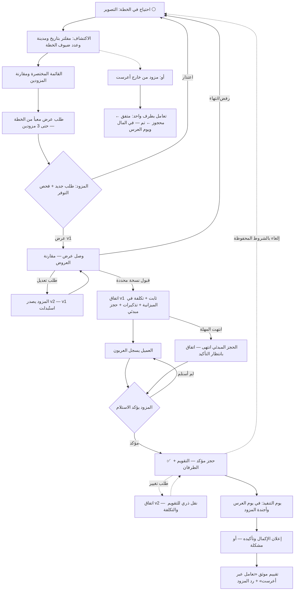

# أعرست — Product Contract لنظام المزودين

التاريخ: 2026-10-05

**الحالة: مقترح للاعتماد — ليس نطاقًا معتمدًا ولا إذن تنفيذ.**

المصدر المرجعي: الفرع `staging/integration-decoupling-20261002`، HEAD `14eccb50`.

## 0. موقع هذه الوثيقة

- هذه الوثيقة تصف **المنتج المطلوب**، ولا تصف الكود الحالي. مهمة Codex بعدها: مقارنتها بالكود وإخراج Gap Matrix، ثم التنفيذ على حزم بعد الاعتماد.
- تغطي نظام المزودين فقط: تبويب الموردين عند صاحب الخطة، ومسار المزود، والعلاقة المشتركة بينهما. المال والضيوف والمهام تُذكر فقط حيث ترتبط مباشرة بدورة المزود.
- **تعارض مع الوثائق المعتمدة:** [PRODUCT.md](../../project/PRODUCT.md) و[DECISIONS.md](../../project/DECISIONS.md) يستبعدان الحجز المؤكد والعربون. اعتماد هذه الوثيقة يعني قرارًا صريحًا بتوسعة النطاق، ثم تحديث PRODUCT وDECISIONS وAPI_CONTRACT وDATABASE قبل التنفيذ. لا يعدّل Codex الوثائق المعتمدة قبل هذا القرار.
- تحل هذه الوثيقة محل الأقسام المنتجية في [المسودة السابقة](2026-10-04-provider-engagement-product-design.md). تبقى قواعد الملكية المعمارية فيها مرجعًا هندسيًا.
- **لا بوابة دفع ولا تحصيل ولا عمولات.** الدفع يحدث خارج أعرست، وأعرست يوثّقه بين الطرفين فقط.

---

## 1. المبادئ المستخلصة

استخرجنا المبادئ من أنماط منصات أسواق المزودين، ومنصات أعراس، وأنظمة الحجز، وأنظمة CRM للمزودين، وأنظمة العروض. لم ننسخ أي منتج.

| المجال | المبدأ | معناه في أعرست |
|---|---|---|
| أسواق المزودين | الثقة تُبنى من التعامل الفعلي، لا من الإعلان | التقييم فقط بعد اتفاق حقيقي، وشارة «تعامل عبر أعرست» |
| منصات الأعراس | العريس يبحث عن **احتياج** وليس عن مزود | التبويب يبدأ من «ماذا ينقصني»، لا من شبكة صور |
| أنظمة الحجز | التوفر حقيقة واحدة يملكها المورد | التقويم عند المزود هو مصدر «متاح/محجوز»، والحجز الخارجي يدخل فيه |
| أنظمة الحجز | الحجز المبدئي له مدة انتهاء | قبول العرض يحجز التاريخ مبدئيًا حتى موعد العربون |
| CRM للمزود | المزود يعمل من **قائمة ما ينتظره** لا من قوائم بيانات | الرئيسية عند المزود = ماذا أفعل اليوم |
| Lead management | سرعة الرد هي أهم عامل للفوز بالعميل | تذكير المزود بالطلبات، وإظهار سرعة الرد في ملفه |
| أنظمة العروض | العرض المرسل وثيقة لا تُعدّل | كل تعديل = نسخة جديدة، والقبول يكون لنسخة محددة |
| العقود | الاتفاق صورة ثابتة من الشروط وقت القبول | الإلغاء والاسترداد يُحكم بالشروط المحفوظة، لا الحالية |
| المدفوعات خارج المنصة | الدفعة تحتاج طرفين: من دفع ومن استلم | العريس يسجل والمزود يؤكد الاستلام، ولا تُكرر الدفعة |
| المحادثة | المحادثة سياق للتعامل لا شبكة اجتماعية | محادثة واحدة لكل علاقة، وكل حدث يظهر فيها كبطاقة |
| السمعة | البلاغ والحظر والتقييم أدوات مختلفة | البلاغ سري للإدارة، والحظر شخصي، والتقييم عام |
| الخصوصية | يحتفظ العميل بهويته حتى يقرر | رقم العريس لا يُرسل للمزود افتراضيًا |

---

## 2. المفاهيم الأساسية

المصطلح الموحد في الواجهة هو **«المزود»**، والتبويب اسمه **«المزودون»**. المطلوب إنهاء الخلط الحالي بين «مورد» و«مزود».

| المفهوم | التعريف | ملاحظة |
|---|---|---|
| **الاحتياج** | خدمة تحتاجها الخطة: القاعة، التصوير، الفنان… | مرتبط بتصنيف مالي واحد في الميزانية. حالته محسوبة من التعاملات، ولا تُكتب يدويًا |
| **التعامل (Engagement)** | العلاقة بين خطة واحدة ومزود واحد لاحتياج واحد | **الحقيقة الواحدة** التي يراها الطرفان. يحتوي الطلبات والعروض والاتفاق والحجز والدفعات والتغييرات والإكمال والتقييم والمحادثة |
| **طلب العرض** | طلب من صاحب الخطة لمزود محدد | يبدأ التعامل |
| **العرض ونُسخه** | رد المزود بالسعر والشروط | كل نسخة مرسلة ثابتة، والتعديل يصدر نسخة جديدة |
| **الاتفاق** | صورة ثابتة من نسخة العرض المقبولة | له نسخ عند قبول طلبات التغيير |
| **الحجز** | قفل التاريخ في تقويم المزود | فقط للمزود الذي يملك قدرة «الحجز بالتاريخ» |
| **سجل الدفع** | دفعة تمت خارج أعرست | تأكيد من طرفين |
| **طلب التغيير** | اقتراح تعديل على اتفاق قائم | لا تعديل صامت أبدًا |
| **الإكمال** | إعلان أن الخدمة نُفذت | يفتح التقييم |
| **المزود الخارجي** | مزود ليس على أعرست يضيفه صاحب الخطة | يدخل نفس نموذج التعامل بطرف واحد |

قاعدة ثابتة: **حالة العرض وحالة الاتفاق وحالة الحجز وحالة الدفع حالات منفصلة**، وليست enum واحدة. ما يراه المستخدم («متفق»، «محجوز»…) **مرحلة محسوبة** منها.

---

## 3. Core Provider + Capabilities

### 3.1 ما يملكه كل مزود (Core)

- حساب في نفس تطبيق أعرست، وطلب انضمام، واعتماد الإدارة.
- ملف النشاط: الاسم، **تصنيف أساسي واحد (MVP)**، المدينة، الوصف، الشعار، الغلاف، معرض الأعمال.
- الخدمات والباقات: العنوان، ما يشمله، «يبدأ من» أو «السعر حسب الطلب».
- قالب الشروط: سياسة العربون والإلغاء، نصوص جاهزة يعدّلها.
- صندوق الطلبات، والعروض بنسخها، والاتفاقات، وسجل الدفعات لكل اتفاق.
- المحادثة والإشعارات والتقييمات (عرض وردّ) والبلاغ والحظر وإعدادات النشاط.

### 3.2 القدرات (Capabilities)

القدرات **تحددها الإدارة كقالب لكل تصنيف**. المزود لا يفعّل أو يعطّل قدرات عشوائيًا.

| القدرة | ماذا تضيف | من يحتاجها |
|---|---|---|
| `FIXED_VENUE` — مكان ثابت | عنوان دقيق وخريطة، سعة الضيوف، أقسام رجال/نساء، صور المكان | القاعات، المخادر، الصالات |
| `MOBILE_SERVICE` — خدمة متنقلة | **منطقة خدمة** (محافظات/مديريات) بدل الموقع الدقيق، رسوم تنقل اختيارية | المصور، الفنان، الكوشة، البوفيه المتنقل، المكياج المنزلي |
| `DATE_BOOKING` — حجز بالتاريخ | تقويم، **سعة** (عدد الحجوزات الممكنة في نفس الفترة)، فترات (صباح/مساء/يوم كامل)، حجز خارجي، أيام مغلقة | كل من يُستهلك وقته أو مكانه في تاريخ محدد |
| `GUEST_COUNT_PRICING` — تسعير بعدد الضيوف | سعر للفرد، حد أدنى/أقصى للعدد، تأثير تغيير العدد على الاتفاق | القاعات، الولائم، البوفيه |
| `PRODUCT_ORDER` — طلب منتج | كمية، موعد استلام/توصيل بدل حجز التاريخ، لا تقويم حصري | الحلويات، الدعوات، التوزيعات، الملابس الجاهزة |
| `DEPOSIT_POLICY` — سياسة عربون | عربون إلزامي/اختياري، مبلغ أو نسبة، مهلة | اختيارية لأي مزود يعمل بعربون |

### 3.3 قوالب التصنيفات (افتراضية — تعتمدها الإدارة)

| التصنيف | القدرات الافتراضية | السعة الافتراضية |
|---|---|---|
| قاعة / مخدرة / صالة نساء | FIXED_VENUE + DATE_BOOKING + GUEST_COUNT_PRICING + DEPOSIT | 1 لكل قاعة لكل فترة (القاعة المتعددة = موارد متعددة) |
| تصوير وفيديو | MOBILE_SERVICE + DATE_BOOKING + DEPOSIT | عدد الفرق |
| فنان / فرقة / شاعر / زفة | MOBILE_SERVICE + DATE_BOOKING + DEPOSIT | 1 لكل فترة |
| كوشة وديكور | MOBILE_SERVICE + DATE_BOOKING + DEPOSIT | عدد الأطقم |
| ولائم / بوفيه / مطابخ | MOBILE_SERVICE أو FIXED_VENUE + DATE_BOOKING + GUEST_COUNT_PRICING + DEPOSIT | عدد الطلبات اليومية |
| مكياج وشعر | MOBILE_SERVICE أو FIXED_VENUE + DATE_BOOKING | عدد الحجوزات في اليوم |
| سيارات الزفة | MOBILE_SERVICE + DATE_BOOKING | عدد السيارات |
| حلويات / دعوات / توزيعات | PRODUCT_ORDER (+ DEPOSIT اختياري) | لا تقويم |
| فساتين / بدل (بيع) | PRODUCT_ORDER | لا تقويم |

### 3.4 ما لا يحتاجه كل مزود

- **بائع المنتج** (حلويات، دعوات): لا تقويم، ولا حجز تاريخ، ولا موقع دقيق إذا كان يوصّل. يحتاج موعد التسليم والكمية فقط.
- **المزود المتنقل** (مصور، فنان): لا خريطة ولا عنوان دقيق. يحتاج منطقة الخدمة فقط.
- **القاعة**: لا تحتاج «منطقة خدمة». عنوانها هو كل شيء.
- **المزود بلا عربون**: لا يُفرض عليه أي حقل أو خطوة عربون. الاتفاق يتأكد بتأكيده المباشر.
- **أي مزود**: لا يُطلب منه ما لا تستخدمه قدراته. الحقول تظهر حسب القدرات.

---

## 4. تبويب المزودين عند صاحب الخطة

### 4.1 البنية

التبويب الخامس «المزودون» فيه ثلاثة أقسام في أعلاه:

1. **احتياجاتي** (الافتراضي) — لوحة الاحتياجات.
2. **اكتشف** — البحث والتصفح.
3. **محفوظاتي** — المفضلة والقوائم المختصرة.

مع أيقونة **الرسائل** في الترويسة، وعليها عدد الرسائل غير المقروءة.

### 4.2 ماذا يرى أول ما يدخل؟ — لوحة الاحتياجات

```
حجزت 3 من 8                          [▓▓▓░░░░░]
────────────────────────────────────────────
القاعة        ✅ محجوزة · قاعة السعادة · 12 مارس
              دفعت 30% · المتبقي 700,000 قبل 1 مارس
التصوير       🟡 وصلك عرضان · قارن واختر          ← [قارن]
الفنان        🟠 أرسلت 3 طلبات · بانتظار الردود
الكوشة        ⚪ لم تبدأ                            ← [ابحث]  [أضفته من خارج أعرست]
الحلويات      ⚪ لم تبدأ
السيارة       — لا أحتاجها
[+ أضف احتياجًا]
```

- **مصدر الاحتياجات:** تصنيفات المال للخطة التي تحتاج مزودًا (القاعة، التصوير…). عند خطة جديدة تُقترح القائمة حسب الدور والمدينة، ويحذف منها أو يضيف.
- **حالة الاحتياج محسوبة**، لا تُكتب يدويًا:

| الحالة | المعنى | الخطوة التالية المعروضة |
|---|---|---|
| لم تبدأ | لا تعامل | ابحث / أضف من خارج أعرست |
| في القائمة المختصرة | مزودون محفوظون بلا طلب | اطلب عروضًا |
| بانتظار الردود | طلبات مرسلة بلا عروض | — (عدّاد الوقت) |
| وصلتك عروض | عرض أو أكثر صالح | قارن واختر |
| متفق — بانتظار التأكيد | اتفاق قائم، والحجز غير مؤكد | سجّل العربون / انتظر تأكيد المزود |
| محجوز | اتفاق مؤكد | المتبقي وموعده |
| تم | الخدمة اكتملت | قيّم المزود |
| لا أحتاج | مخفي من العدّاد | — |

- **العدّاد «حجزت X من Y»** = الاحتياجات المؤكدة أو المكتملة من غير المستبعدة.
- **الترتيب:** حسب الإلحاح، أي ما يحتاج قرارًا الآن وما يُحجز مبكرًا عادة (القاعة قبل الحلويات).
- كل بطاقة احتياج تفتح **صفحة الاحتياج**.

### 4.3 صفحة الاحتياج (مثال: التصوير)

- **ملخص المتطلبات** من الخطة: التاريخ، المدينة/المكان، عدد الضيوف، المبلغ المخصص في الميزانية (يراه صاحب صلاحية المال فقط، ولا يُرسل للمزود).
- **التعاملات**: كل مزود تعامل معه في هذا الاحتياج وحالته.
- **مقارنة العروض** متى وُجد عرضان أو أكثر.
- **أزرار:** «ابحث عن مصور»، «أضف مزودًا من خارج أعرست»، «لا أحتاج هذا».

### 4.4 الاكتشاف

**المدخل:** من صفحة الاحتياج يدخل والتصنيف والتاريخ والمدينة وعدد الضيوف مفلترة مسبقًا من الخطة. ومن قسم «اكتشف» يدخل بلا فلاتر.

**التصنيفات:** شريط تصنيفات بأيقونات، بالترتيب نفسه لاحتياجات الخطة.

**البحث:** بالاسم أو الخدمة («تصوير نسائي»، «زفة»)، مع اقتراحات أثناء الكتابة.

**الفلاتر:**

| الفلتر | يظهر لـ | ملاحظة |
|---|---|---|
| المدينة/منطقة الخدمة | الكل | افتراضيًا مدينة الخطة. المزود المتنقل يظهر إذا كانت منطقة خدمته تشمل مديرية الخطة |
| **متاح في تاريخي** | من يملك DATE_BOOKING | ثلاث حالات صادقة: متاح / محجوز / **اسأل عن التوفر** إذا لم يحدّث المزود تقويمه منذ مدة |
| السعر «يبدأ من» | الكل | نطاق |
| سعة الضيوف | FIXED_VENUE | يتطابق مع عدد ضيوف الخطة |
| أقسام رجال/نساء | FIXED_VENUE | — |
| التقييم | الكل | — |
| الباقات فقط | الكل | — |

**الترتيب:** «الأنسب» (يجمع تطابق المنطقة والتوفر في التاريخ واكتمال الملف والتقييم وسرعة الرد)، ثم السعر، ثم التقييم. **لا ترتيب مدفوع في MVP.** وإذا وُجد «مميز» فيظهر بوسم واضح.

**بطاقة المزود في النتائج:** صورة الغلاف، الاسم، التصنيف، المنطقة، «يبدأ من»، التقييم وعدد المقيّمين، **شارة التوفر لتاريخي**، سرعة الرد، زر الحفظ.

**الموقع:** خريطة فقط للمكان الثابت. المزود المتنقل يظهر بمنطقة خدمته.

### 4.5 ملف المزود

بالترتيب:
1. **الترويسة:** الاسم، التصنيف، المنطقة، التقييم، سرعة الرد، «على أعرست منذ»، شارة التوفر لتاريخ الخطة.
2. **معرض الأعمال:** ألبومات (حفلات سابقة، المكان، العينات)، وعرض بملء الشاشة.
3. **الباقات:** ما يشمل وما لا يشمل، «يبدأ من»، وزر «اطلب عرضًا لهذه الباقة».
4. **الشروط باختصار:** العربون (نسبة/مبلغ ومهلة)، سياسة الإلغاء والاسترداد.
5. **للمكان الثابت:** السعة، الأقسام، الخريطة، الخدمات المرفقة.
6. **للمتنقل:** منطقة الخدمة ورسوم التنقل.
7. **التقييمات:** المتوسط والتوزيع، مع وسم **«تعامل عبر أعرست»** للتقييمات الموثقة، وردود المزود.
8. **أزرار ثابتة أسفل الشاشة:** «اطلب عرض سعر» (الأساسي)، و«احفظ».

لا يوجد زر «راسله» مستقل. المحادثة تبدأ من طلب حقيقي، والطلب نفسه فيه خانة سؤال.

**رقم المزود:** يقرر المزود هل يظهر رقمه للعامة. افتراضيًا يظهر بعد إرسال طلب.

### 4.6 المحفوظات والمقارنة

- **المفضلة مرتبطة بالاحتياج:** عند الحفظ يُسأل «لأي احتياج؟» (يُستنتج من التصنيف تلقائيًا).
- **مقارنتان مختلفتان:**
  1. **مقارنة المزودين** قبل الطلب: حتى 3 من نفس التصنيف. الحقول حسب القدرات: «يبدأ من»، التقييم، التوفر لتاريخي، السعة (للقاعات)، ما تشمله الباقة، سياسة العربون، سرعة الرد. ومنها زر **«اطلب عرضًا من الثلاثة»**.
  2. **مقارنة العروض** بعد وصولها: الإجمالي، ما يشمل وما لا يشمل، العربون ومهلته، الإلغاء، صلاحية العرض، التوفر الحالي. الفروق مظللة. ومنها «اقبل» أو «اطلب تعديلًا».

### 4.7 طلب عرض السعر

**يستخدم بيانات الخطة بدل تكرار الأسئلة.** يرى ملخصًا معبأً ويعدّل ما يريد:

| الحقل | المصدر | إلزامي؟ |
|---|---|---|
| الاحتياج والخدمة/الباقة | من مكان الدخول | نعم |
| التاريخ | تاريخ الخطة، أو «مرن» مع نطاق، أو «لم نحدد» | نعم (يقبل «مرن») |
| الفترة | صباح/مساء/يوم كامل | لـDATE_BOOKING |
| المكان | مدينة الخطة ومديريتها، أو «القاعة: X» إذا كانت محجوزة | نعم |
| عدد الضيوف | من الضيوف أو التقدير، مع تقسيم رجال/نساء | لـGUEST_COUNT_PRICING والقاعات |
| الميزانية لهذا الاحتياج | من الميزانية | **لا، ومخفية افتراضيًا.** يختار «شارك نطاقًا تقريبيًا» |
| ملاحظات وأسئلة | نص حر | لا |
| صور إلهام | مرفقات | لا |
| طريقة التواصل | **المحادثة داخل أعرست فقط (افتراضي)** / شارك رقمي مع هذا المزود | نعم |

- **معاينة قبل الإرسال:** «هذا ما سيراه المزود»، ويظهر فيها بوضوح ما لن يُرسل.
- **إرسال لأكثر من مزود:** من القائمة المختصرة، حتى 3 دفعة واحدة. كل طلب مستقل، ولا يعلم المزودون ببعضهم.
- **حد مكافحة الإزعاج:** حد أقصى للطلبات المفتوحة لكل احتياج (افتراضيًا 5).
- يُحفظ كمسودة محلية، والإرسال يحتاج اتصالًا.

### 4.8 بعد إرسال الطلب

- يظهر الطلب في صفحة الاحتياج بحالته: **أُرسل ← شوهد ← وصل عرض**، أو **اعتذر المزود (مع السبب)**، أو **انتهى بلا رد**.
- **توقع صادق:** «يرد هذا المزود عادة خلال يوم».
- بعد 7 أيام بلا عرض ينتهي الطلب تلقائيًا، ويُقترح مزودون مشابهون.
- تُفتح محادثة التعامل، وأول بطاقة فيها «طلب عرض» بتفاصيله.

### 4.9 العرض والتفاوض

**بطاقة العرض:** الإجمالي، البنود المشمولة وغير المشمولة، التاريخ والفترة، العربون (المبلغ والمهلة)، جدول الدفع المقترح، سياسة الإلغاء، صلاحية العرض، المرفقات، ورقم النسخة.

**الأفعال المتاحة لصاحب الخطة:**
- **اقبل**.
- **اطلب تعديلًا**: يختار نوعه (السعر / ما يشمله / الموعد / أخرى) ويكتب ملاحظة. يصدر المزود **نسخة جديدة**، والقديمة تُعلّم «استُبدلت» وتبقى في السجل مع إبراز الفروق.
- **ارفض** مع سبب اختياري، ويصل المزودَ ردٌّ مهذب.
- انتهاء صلاحية العرض يظهر بوضوح، ومعه زر «اطلب تجديده» (= طلب تعديل).

### 4.10 القبول والاتفاق

**شاشة مراجعة قبل القبول:**

```
ستقبل: عرض استوديو النور — النسخة 2
الإجمالي 600,000 ر.ي · عربون 150,000 قبل 1 فبراير
الإلغاء: العربون غير مسترد بعد 15 فبراير

بقبولك سيحدث:
• تُضاف تكلفة 600,000 في «التصوير والفيديو» بميزانيتك (مدفوع: 0)
• يُضاف تذكير العربون وتذكير المتبقي
• يُحجز التاريخ مبدئيًا عند المزود حتى 1 فبراير
• يُبلَّغ المزود
[ ] أغلق طلباتي الأخرى للتصوير وأبلغهم بلطف (مختار افتراضيًا)
[تأكيد القبول]
```

- القبول **لنسخة محددة**. إذا تغيّرت النسخة أو انتهت أو امتلأ التقويم أثناء المراجعة، يُرفض القبول برسالة واضحة.
- **الاتفاق:** صفحة ثابتة فيها صورة الشروط ووقت القبول وأسماء الطرفين وسجل نسخه.

### 4.11 العربون والحجز والدفعات

- بعد الاتفاق تعرض صفحة التعامل: **«الخطوة التالية: ادفع العربون للمزود ثم سجّله هنا»**.
- **سجّل دفعة:** المبلغ، التاريخ، الطريقة (نقد/تحويل/حوالة)، صورة الإيصال (اختيارية). الدفعة تُحتسب فورًا في مالي، وتظهر للمزود «بانتظار تأكيد الاستلام».
- **يؤكد المزود الاستلام** فيتأكد الحجز: «✅ تأكد حجزك».
- إذا قال المزود «لم أستلم» تُعلَّم الدفعة «متنازع عليها»، ولا تُحذف من مالي.
- إذا سجّل المزود استلامًا لم أسجله (دفعت له نقدًا مثلًا)، يصلني **«المزود يقول إنه استلم 50,000 — طابِق»**. أطابقها مع دفعة موجودة، أو أسجلها، أو أرفضها.
- **المتبقي وموعده** ظاهران في صفحة التعامل وفي المال.

### 4.12 المحادثة والملفات

- **محادثة واحدة لكل تعامل.** كل حدث يظهر فيها كبطاقة: طلب، عرض v1، طلب تعديل، عرض v2، قبول، دفعة مسجلة، استلام مؤكد، تغيير مقترح، إلغاء، إكمال.
- **الملفات:** قسم «ملفات التعامل» يجمع مرفقات المحادثة والعروض والإيصالات. خاص بالطرفين، ولا يظهر للعامة.

### 4.13 التغييرات بعد الاتفاق

- أي طرف يقترح **طلب تغيير**: موعد، فترة، سعر، بنود، عدد ضيوف، أو إلغاء بالتراضي.
- يرى الطرف الآخر «قبل/بعد» ويقبل أو يرفض. **الاتفاق القائم يبقى ساريًا حتى القبول.**
- القبول يصدر **نسخة اتفاق جديدة**، ويحدّث التكلفة والتذكيرات والتقويم معًا.
- **تغيّر في الخطة ينعكس كاقتراح لا كتعديل:**
  - تغيير تاريخ العرس: يُسأل صاحب الخطة «لديك 3 مزودين محجوزين بالتاريخ القديم — أرسل لهم طلب تغيير موعد؟».
  - تغيّر عدد الضيوف: يُقترح طلب تغيير للقاعة والوليمة فقط.

### 4.14 الإلغاء

- زر «إلغاء الاتفاق» يعرض **شروط الإلغاء المحفوظة** وأثرها: «العربون 150,000 غير مسترد حسب الاتفاق».
- السبب إلزامي، ويُبلَّغ المزود فورًا.
- التكلفة تُعلَّم ملغاة دون حذف ما دُفع. والمبلغ المسترد يُسجّل كاسترداد لاحقًا.
- الاحتياج يعود «لم يُحجز» مع بقاء السجل، ويُقترح مزودون بديلون.

### 4.15 الإكمال والتقييم

- بعد تاريخ الخدمة يُسأل الطرفان: «هل تمت الخدمة؟».
- إذا أعلن المزود الإكمال، يؤكد صاحب الخطة أو يختار «هناك مشكلة».
- **التقييم متاح لصاحب الخطة بعد تاريخ الخدمة إذا كان الاتفاق مؤكدًا**، حتى لو لم يعلن المزود الإكمال. لا يستطيع المزود منع التقييم بالامتناع.
- **التقييم:** نجوم عامة، وتفاصيل اختيارية (الالتزام بالموعد، الجودة، حسن التعامل، مطابقة الاتفاق)، ونص، وصور.
- تقييم واحد لكل اتفاق، قابل للتعديل خلال 30 يومًا. والمزود يرد مرة واحدة.
- إلغاء المزود بعد التأكيد يتيح تقييم «تجربة الإلغاء».

### 4.16 البلاغ والحظر

- **البلاغ:** من الملف أو المحادثة أو التقييم. الأسباب: احتيال، إساءة، محتوى غير لائق، معلومات كاذبة، أخرى. البلاغ **سري للإدارة**. يرى المُبلِّغ «وصل بلاغك» فقط، ولا يعلم المُبلَّغ عنه. **لا عقوبة تلقائية.**
- **الحظر:** شخصي ومنفصل عن البلاغ. يوقف الرسائل والطلبات والعروض الجديدة بين الطرفين. إذا كان هناك اتفاق قائم، يُنبَّه صاحب الخطة إلى أن الاتفاق يبقى للقراءة، ويُقترح الإلغاء أولًا. المحظور يرى «لا يمكن الإرسال» دون تفاصيل.

### 4.17 مزود من خارج أعرست

- من صفحة الاحتياج: **«أضفته من خارج أعرست»**.
- الحقول: الاسم، الرقم (خاص بي)، المبلغ المتفق، العربون، التاريخ، الشروط، صورة العقد أو الإيصال.
- يُنشأ **نفس نوع التعامل**، لكن بطرف واحد: صاحب الخطة يعلن الحالات بنفسه (متفق ← محجوز ← تم)، ولا يوجد تأكيد من مزود.
- ينعكس كاملًا على: التكلفة في الميزانية (الطرف الخارجي مدعوم اليوم)، والتذكيرات، وحالة الاحتياج، وأرقام يوم العرس.
- **لا تقييم عام** للمزود الخارجي.
- **لاحقًا:** «ادعُه إلى أعرست» يرسل رابط تسجيل للمزود. انضمامه لا يربط بيانات الخطة به تلقائيًا.

---

## 5. مسار المزود

افترضنا أنك صاحب قاعة أو مصور أو فنان، وتستخدم أعرست يوميًا لإدارة عملك.

### 5.1 التسجيل والانضمام

1. من نفس التطبيق: **«أنا مزود خدمة»**.
2. حساب برقم الهاتف وOTP. إذا كان عنده حساب عريس، يضيف سياق مزود لنفس الحساب.
3. **طلب الانضمام**: اسم النشاط، **تصنيف أساسي واحد**، المدينة، رقم التواصل، وصف قصير، 3 صور على الأقل من الأعمال، وحسب القدرات: العنوان أو منطقة الخدمة.
4. **إرسال للمراجعة** ← حالة «قيد المراجعة».

### 5.2 حالة الاعتماد

| الحالة | ما يراه المزود | ما يستطيعه |
|---|---|---|
| قيد المراجعة | «طلبك قيد المراجعة» مع **قائمة تجهيز**: أكمل الملف، أضف باقة، اكتب شروطك، جهّز التقويم | يجهّز كل شيء بشكل **غير منشور**، ومعاينة «هكذا سيظهر ملفك» (لا الرابط العام) |
| يحتاج تعديلات | ملاحظات الإدارة **مرتبطة بالحقول** | يعدّل ويعيد الإرسال |
| معتمد | «ملفك منشور» مع قائمة البداية | كل العمليات |
| مرفوض | السبب | قراءة، وإعادة التقديم بعد مدة إن سمحت السياسة |
| موقوف | السبب، و«الاتفاقات القائمة مستمرة» | لا طلبات ولا عروض جديدة. يكمل التزاماته الحالية ويتواصل بشأنها |

**لا يظهر للعامة قبل الاعتماد.**

### 5.3 الرئيسية — «ماذا ينتظرني اليوم؟»

```
اليوم: حفلتان — 4:00 م عرس آل أحمد (قاعة 1) · 8:00 م عرس آل سالم
──────────────────────────────
يحتاج ردك
• 3 طلبات جديدة (أقدمها منذ 20 ساعة)            ← [رد]
• عربون سجّله عميل بانتظار تأكيدك: 150,000     ← [أكّد]
• طلب تغيير موعد من آل علي                       ← [راجع]
• عرض ينتهي غدًا ولم يُفتح بعد
• 2 رسائل بلا رد
──────────────────────────────
هذا الأسبوع: 5 حجوزات · هذا الشهر: 18 مؤكدة · سرعة ردك: خلال 3 ساعات
```

### 5.4 الطلبات (Leads)

- **الأقسام:** جديدة / بانتظار عرضي / عرض مرسل / متفق / مغلقة (اعتذار، رفض، انتهاء).
- **بطاقة الطلب:** الخدمة، التاريخ والفترة، المدينة والمنطقة، عدد الضيوف، الميزانية (إن شاركها العميل)، و**فحص تلقائي للتوفر**: «متاح» / «عندك حجز في هذا التاريخ» / «عندك 2 عروض مرسلة لنفس التاريخ».
- **هوية العميل:** اسمه الأول والخطة («عرس أحمد»)، و**لا رقم إلا إذا شاركه**.
- **الأفعال:** أنشئ عرضًا / اعتذر (السبب: غير متاح، خارج نطاقي، أخرى) / اسأل في المحادثة.

### 5.5 إنشاء العرض ونسخه

- **من باقة أو مخصص.**
- **الحقول:**
  - البنود المشمولة وغير المشمولة.
  - السعر، بعملة الخطة فقط.
  - التاريخ والفترة.
  - لمن يسعّر بعدد الضيوف: سعر الفرد × العدد.
  - العربون: مبلغ أو نسبة، ومهلة.
  - جدول الدفع المقترح: العربون، ثم المتبقي قبل الموعد بكذا.
  - **سياسة الإلغاء** من قالبه.
  - صلاحية العرض، والمرفقات.
- **معاينة «هكذا يراه العميل»** قبل الإرسال.
- **بعد الإرسال لا تعديل.** «عدّل العرض» يصدر نسخة جديدة، ويرى العميل الفروق.
- **التتبع:** أُرسل ← فُتح ← طُلب تعديل ← قُبل / رُفض / انتهى / سحبته.

### 5.6 الاتفاقات والعملاء

- **الاتفاقات:** كل اتفاق بحالته (بانتظار العربون / مؤكد / منفذ / مكتمل / ملغي)، وإجماليه، والمستلم، والمتبقي، والموعد القادم.
- **العملاء:** قائمة بكل من تعامل معه، تفتح **سجل التعامل الكامل**: الطلبات، النسخ، الاتفاق ونسخه، الدفعات، التغييرات، المحادثة، الملفات، التقييم.

### 5.7 التقويم والتوفر (لمن يملك DATE_BOOKING فقط)

- **عرض شهري** وتفاصيل اليوم بالفترات، ولكل مورد (قاعة 1، قاعة 2، فريق أ…).
- **الألوان:** مؤكد / مبدئي (بانتظار العربون، مع موعد انتهاء) / حجز خارجي / مغلق / متاح.
- **حجز خارجي:** يضيف حجزًا لعميل من خارج أعرست بتسمية اختيارية فقط، **بلا بيانات العميل**. يُنقص السعة كأي حجز.
- **أيام مغلقة** وإجازات.
- **منع التعارض:** لا يمكن تأكيد حجز يتجاوز السعة. والقبول عند العميل يُرفض إذا امتلأ التاريخ.
- **حداثة التقويم:** إذا لم يحدّثه منذ 30 يومًا، يظهر للعملاء «اسأل عن التوفر» بدل «متاح»، ويُذكَّر المزود بالتحديث.

**لمن يملك PRODUCT_ORDER:** قسم **«الطلبات المؤكدة»** مرتب حسب موعد التسليم، بدل التقويم.

### 5.8 المدفوعات والمتبقي

- **لكل اتفاق:** المتفق عليه، المستلم المؤكد، المتبقي، والموعد القادم.
- **بانتظار تأكيدي:** دفعات سجلها العملاء، أؤكد الاستلام أو أقول «لم أستلم».
- **سجّل استلامًا:** إذا استلمت ولم يسجل العميل، فيصله طلب مطابقة.
- **لا يرى المزود أبدًا:** ميزانية الخطة، ولا تكاليفها الأخرى، ولا مزوديها الآخرين.

### 5.9 المحادثات والملفات والإشعارات

- **قائمة المحادثات:** كل محادثة مرتبطة بتعامل، ومعها حالته.
- **الملفات:** لكل تعامل.
- **الإشعارات:** انظر §9.

### 5.10 التغييرات والإلغاء

- **يقترح طلب تغيير** (موعد، سعر، بنود)، ولا يعدّل الاتفاق مباشرة.
- **يلغي** بسبب إلزامي، ويرى أثره: إشعار العميل، وتحرر التاريخ، وتأثير الإلغاء على سمعته (نسبة الإلغاء تظهر للإدارة في MVP).

### 5.11 التقييمات والبلاغات

- يرى التقييمات، ويرد مرة واحدة على كل تقييم، ويُبلّغ عن تقييم مسيء (سري، بلا حذف تلقائي).
- يبلّغ عن عميل أو يحظره.

### 5.12 إعدادات النشاط

- بيانات النشاط والتواصل، و**إظهار رقمي للعامة** (نعم/لا).
- قوالب الشروط (عربون وإلغاء).
- الموارد والسعة والفترات (لمن يحجز بالتاريخ).
- ساعات العمل، و**إيقاف مؤقت** (يختفي من الاكتشاف دون أن يتأثر ما هو قائم).
- تفضيلات الإشعارات، والحساب.

---

## 6. الدورة المشتركة: حقيقة واحدة من جهتين

### 6.1 آلات الحالات

**أ. طلب العرض**
`أُرسل → شوهد → عُرض عليه` أو `اعتذر المزود` أو `ألغاه العميل` أو `انتهى (7 أيام بلا عرض)`. وبعد القبول: `مقبول`.

**ب. نسخة العرض**
`مسودة (عند المزود) → أُرسلت → فُتحت → [استُبدلت | سُحبت | انتهت | رُفضت | قُبلت]`

**ج. الاتفاق**
`نشط — بانتظار التأكيد` (عند الحاجة لعربون/تأكيد) `→ مؤكد → بانتظار تأكيد الإكمال → مكتمل`
ومنه: `ملغي من العميل` / `ملغي من المزود` / `ملغي بالتراضي` / `فيه مشكلة`.
بلا قدرة DATE_BOOKING ولا عربون: القبول يجعله `مؤكد` مباشرة إن اختار المزود ذلك في العرض.

**د. الحجز** (لـDATE_BOOKING فقط)
`مبدئي (له موعد انتهاء) → مؤكد → منفذ`
ومنه: `مُحرَّر` (عند الإلغاء) / `انتهى المبدئي` (لم يتأكد قبل المهلة).

**هـ. سجل الدفع**
- سجّله العميل: `يُحتسب في مال العميل فورًا → بانتظار تأكيد المزود → مؤكد` أو `متنازع عليه`.
- سجّله المزود: `بانتظار مطابقة العميل → مُطابَق (يصبح دفعة مؤكدة)` أو `مرفوض`. **لا يُحتسب في مال العميل قبل المطابقة.**
- العكس: `معكوسة` بسبب، مع بقاء السجل.

**و. طلب التغيير**
`مُقترح → [مقبول (نسخة اتفاق جديدة) | مرفوض | مسحوب | منتهٍ]`

**ز. التقييم**
`متاح → منشور → [مخفي بقرار الإدارة]`، ومعه رد المزود.

**المرحلة المعروضة للتعامل** (محسوبة): محفوظ ← طلب مرسل ← وصل عرض ← متفق ← محجوز ← منفذ ← مكتمل/مُقيَّم، أو ملغي.

### 6.2 جدول الانتقالات

اختصارات: **ع** = صاحب الخطة (بصلاحية المزودين)، **م** = المزود، **ن** = النظام، **إ** = الإدارة.

| # | الفعل | من | يتغير | ماذا يرى الطرف الآخر | الإشعار | الحجز | المال | التقويم | المحادثة والسجل |
|---|---|---|---|---|---|---|---|---|---|
| 1 | يحفظ مزودًا | ع | قائمة مختصرة | لا شيء | — | — | — | — | سجل خاص بالعميل |
| 2 | يرسل طلب عرض | ع | طلب: أُرسل. تعامل جديد أو قائم | طلب جديد في «جديدة» مع فحص التوفر | م: «طلب جديد: تصوير · 12 مارس · صنعاء» (عالٍ) | — | — | علامة «استفسار» اختيارية، **بلا حجز** | تُنشأ المحادثة أو تُستخدم، بطاقة «طلب عرض» |
| 3 | يفتح الطلب | م | طلب: شوهد | «شوهد» | — | — | — | — | — |
| 4 | يعتذر | م | طلب: اعتذر | الاعتذار وسببه، واقتراح مشابهين | ع: عادي | — | — | — | بطاقة «اعتذار» |
| 5 | يلغي الطلب | ع | طلب: ملغى | الطلب انتقل إلى «مغلقة» | م: منخفض | — | — | — | بطاقة |
| 6 | 24/72 ساعة بلا رد | ن | — | — | م: تذكير | — | — | — | — |
| 7 | 7 أيام بلا عرض | ن | طلب: انتهى | انتهى | ع وم | — | — | — | بطاقة |
| 8 | يرسل عرضًا v1 | م | نسخة: أُرسلت، طلب: عُرض | العرض في صفحة الاحتياج والمقارنة | ع: «وصلك عرض» (عالٍ) | — | — | تحذير للمزود إذا كان التاريخ مزدحمًا | بطاقة «عرض v1» |
| 9 | يفتح العرض | ع | نسخة: فُتحت | «فُتح عرضك» | — | — | — | — | — |
| 10 | يطلب تعديلًا | ع | علامة «مطلوب تعديل» | الطلب المنظّم | م: عالٍ | — | — | — | بطاقة «طلب تعديل» |
| 11 | يرسل v2 | م | v1 استُبدلت، v2 أُرسلت | النسخة الجديدة مع الفروق | ع: عالٍ | — | — | — | بطاقة «عرض v2» |
| 12 | يسحب العرض | م | نسخة: سُحبت | «سُحب العرض» | ع: عادي | — | — | — | بطاقة |
| 13 | تنتهي الصلاحية | ن | نسخة: انتهت | «انتهى»، وزر طلب التجديد | ع وم | — | — | — | بطاقة |
| 14 | يرفض العرض | ع | نسخة: رُفضت، الطلب مغلق | الرفض وسببه إن وُجد | م: عادي | — | — | — | بطاقة |
| 15 | **يقبل نسخة** | ع (المزودون + إدارة المال) | نسخة: قُبلت، **اتفاق v1** (صورة ثابتة) | **اتفاق جديد** في «متفق» | م: «قُبل عرضك» (عاجل) | **مبدئي** حتى مهلة العربون (لـDATE_BOOKING) | **تكلفة** بالإجمالي في تصنيف الاحتياج (مدفوع 0) + **تذكيرات** العربون والمتبقي | «مبدئي» عند المزود | بطاقة «اتفاق»، وطلبات الاحتياج الأخرى تُغلق إن اختار |
| 16 | يسجل دفع عربون | ع (إدارة المال) | دفع: بانتظار تأكيد المزود | «سجّل العميل 150,000 — أكّد» | م: عالٍ | — | **دفعة** تُحتسب في مال العميل، والتذكير يُغلق إن اكتمل | — | بطاقة «دفعة مسجلة» |
| 17 | يؤكد الاستلام | م | دفع: مؤكد. إن تحقق شرط العربون: **اتفاق مؤكد** | «✅ تأكد حجزك» | ع: عالٍ | مبدئي ← **مؤكد** | لا دفعة جديدة | ← مؤكد | بطاقة «تأكد الحجز» |
| 18 | «لم أستلم» | م | دفع: متنازع | علامة على الدفعة | ع: عالٍ | يبقى مبدئيًا | **لا حذف**، العميل يعكس إن أخطأ | — | بطاقة |
| 19 | يسجل استلامًا | م | دفع: بانتظار المطابقة | «طابِق 50,000» | ع: عالٍ | — | **لا شيء قبل المطابقة** | — | بطاقة |
| 20 | يطابق | ع (إدارة المال) | دفعة مؤكدة (ربط بموجودة أو إنشاء) | «طابق العميل» | م | قد يتأكد الحجز | دفعة واحدة فقط | — | بطاقة |
| 21 | يؤكد بلا عربون | م | اتفاق: مؤكد | «تأكد حجزك» | ع: عالٍ | ← مؤكد | — | ← مؤكد | بطاقة |
| 22 | تنقضي المهلة | ن | حجز: انتهى المبدئي. الاتفاق يبقى «بانتظار التأكيد» مع تحذير | «تاريخك لم يعد محميًا» | ع وم: عالٍ | يتحرر التاريخ | — | يتحرر | بطاقة |
| 23 | يقترح تغييرًا | ع أو م | تغيير: مُقترح | قبل/بعد | الآخر: عالٍ | — | — | — | بطاقة |
| 24 | يقبل التغيير | الطرف الآخر | **اتفاق v(n+1)** | النسخة الجديدة | المقترِح | نقل ذري: يُحجز الجديد قبل تحرير القديم، وإلا يُرفض | تحديث إجمالي التكلفة **مع سجل**، واقتراح تعديل التذكيرات | نقل | بطاقة بالفروق |
| 25 | يرفض أو يسحب أو ينتهي التغيير | — | تغيير مغلق | — | المقترِح | — | — | — | بطاقة |
| 26 | يلغي الاتفاق | ع | اتفاق: ملغى من العميل | «ألغى العميل» والسبب | م: عاجل | **مُحرَّر** | التكلفة ملغاة، **المدفوع محفوظ**، والاسترداد يُسجل لاحقًا | يتحرر | بطاقة بالشروط المطبقة |
| 27 | يلغي الاتفاق | م | اتفاق: ملغى من المزود | الإلغاء والسبب، واقتراح بدائل | ع: عاجل | مُحرَّر | كما في 26 | يتحرر | بطاقة. يُفتح «تقييم الإلغاء»، ويُحسب في نسبة إلغاء المزود |
| 28 | قبل الموعد بيوم | ن | — | — | ع وم: تذكير | — | تذكير المتبقي إن وُجد | — | — |
| 29 | يعلن الإكمال | م | اتفاق: بانتظار تأكيد الإكمال | «أكّد أو أبلغ عن مشكلة» | ع | — | — | — | بطاقة |
| 30 | يؤكد الإكمال | ع | اتفاق: **مكتمل**، حجز: منفذ | «اكتمل» | م | منفذ | تذكير المتبقي غير المدفوع | — | بطاقة. التقييم يُفتح |
| 31 | «هناك مشكلة» | ع | اتفاق: فيه مشكلة | المشكلة | م: عالٍ | — | — | — | بطاقة. اقتراح البلاغ للإدارة |
| 32 | 7 أيام بعد إعلان الإكمال بلا رد | ن | مكتمل | — | ع وم | منفذ | — | — | بطاقة |
| 33 | ينشر تقييمًا | ع | تقييم منشور، والمتوسط يتحدث | التقييم | م | — | — | — | سجل |
| 34 | يرد على التقييم | م | رد منشور | الرد | ع | — | — | — | — |
| 35 | يُبلّغ | ع أو م | بلاغ مفتوح لدى الإدارة | **لا شيء** | إ | — | — | — | سجل الإدارة فقط |
| 36 | يحظر | ع أو م | حظر | «لا يمكن الإرسال» | — | الاتفاقات القائمة تبقى للقراءة | — | — | — |
| 37 | تعتمد المزود | إ | مزود: معتمد | — | م | — | — | — | — |
| 38 | توقف المزود | إ | مخفي، والطلبات المفتوحة تُغلق | تُغلق الطلبات بإشعار، وأصحاب الاتفاقات يُبلَّغون «المزود موقوف — الاتفاق قائم» | ع المتأثرون وم | لا يتغير | لا يتغير | لا يتغير | بطاقة |

### 6.3 قواعد عامة للدورة

- **كل فعل يكتب بطاقة في المحادثة**، فالمحادثة هي سجل التعامل المقروء للطرفين.
- **لا يتغير شيء متفق عليه بصمت.** أي تغيير على اتفاق مقبول يمر بطلب تغيير.
- **كل فعل حساس ذو أثر واحد:** إعادة الضغط أو انقطاع الشبكة لا تكرر التكلفة أو الدفعة أو الحجز.
- **ما يعرضه أي مكان يُحسب من التعامل نفسه:** صفحة الاحتياج، والرئيسية، والمال، ويوم العرس، وتقويم المزود، واتفاقاته.

---

## 7. المال والعربون والحجوزات

| الحدث | أثره في مال صاحب الخطة | أثره عند المزود |
|---|---|---|
| قبول العرض | تكلفة واحدة بالإجمالي في تصنيف الاحتياج، مدفوعها 0. **تذكيرات** العربون والمتبقي من جدول العرض | اتفاق بإجمالي ومتبقٍ كامل |
| تسجيل دفعة من العميل | دفعة فعلية تُحتسب فورًا | «بانتظار تأكيدك» |
| تأكيد المزود | لا جديد، فقط علامة «مؤكد» | المستلم يزيد |
| استلام سجله المزود | **لا شيء** حتى المطابقة | «بانتظار مطابقة العميل» |
| قبول تغيير بالسعر | يتحدث الإجمالي مع سجل النسخ. لا يُقبل إجمالي أقل من المدفوع إلا مع استرداد | الإجمالي الجديد |
| الإلغاء | التكلفة ملغاة، والمدفوع محفوظ، والاسترداد يُسجل كحدث مستقل | الاتفاق ملغى، والمستلم محفوظ |
| تغيير عدد الضيوف (تسعير بالفرد) | **اقتراح** طلب تغيير، لا تعديل تلقائي | يصله الاقتراح |

**قواعد ثابتة:**
- المزود لا يكتب أبدًا في مال الخطة. أعرست يطابق ما يعلنه المزود مع ما يسجله صاحب الخطة.
- الإجمالي المدفوع لا يعتمد إلا على الدفعات التي سجلها صاحب الخطة أو طابقها.
- القبول بعملة الخطة فقط، بلا تحويل عملات.
- **قرار مطلوب:** القاعدة الحالية تمنع أن ينشئ القبول تذكيرات. هذه الوثيقة تقترح إنشاء تذكيرات العربون والمتبقي من جدول العرض. ويجب أن تُنشأ مرة واحدة فقط، وأن يستطيع صاحب الخطة تعديلها.
- **قرار مطلوب:** سياسة تسجيل الاسترداد في المال، أي كيف يظهر المبلغ المسترد بعد الإلغاء.

---

## 8. الصلاحيات

| الفعل | من يستطيع |
|---|---|
| التصفح والحفظ | أي حساب. الحفظ يحتاج تسجيل الدخول |
| إرسال الطلب، المحادثة، طلب التعديل، رفض العرض | المالك، أو مساهم بصلاحية «المزودون والعروض» |
| رؤية مبالغ العروض والاتفاقات | من يملك صلاحية «المزودون والعروض» |
| رؤية الميزانية والمدفوع | من يملك «مشاهدة المال» فقط، ولا يرسلها للمزود إلا باختياره |
| **قبول العرض، طلب تغيير السعر، الإلغاء** | المالك، أو مساهم يملك **«المزودون والعروض» + «إدارة المال»** معًا |
| تسجيل الدفعات ومطابقتها | «إدارة المال» |
| تأكيد الإكمال والتقييم | المالك، أو من قبل الاتفاق بصلاحيته. تقييم واحد لكل اتفاق |
| البلاغ والحظر | أي طرف في التعامل |
| المزود (MVP) | صاحب حساب المزود وحده. **لاحقًا:** موظفون بصلاحيات (رد على الطلبات، تقويم، مال) |
| الإدارة | اعتماد وإيقاف ومراجعة البلاغات والتقييمات. **لا تعدّل الاتفاقات ولا الدفعات.** ترى محتوى المحادثة فقط في البلاغ المحدد |

- **رقم صاحب الخطة** لا يُرسل إلا إذا اختار «شارك رقمي» لمزود بعينه. ويُقترح عليه ذلك عند تأكيد الحجز.
- **سحب صلاحية** مساهم أثناء التعامل يوقف أفعاله فورًا. ما فعله يبقى في السجل.

---

## 9. الإشعارات

| الحدث | المستلم | الأولوية | يفتح |
|---|---|---|---|
| طلب عرض جديد | المزود | عالية | الطلب |
| تذكير: طلب بلا رد 24/72 ساعة | المزود | عادية | الطلب |
| وصل عرض / نسخة جديدة | صاحب الخطة | عالية | العرض |
| فُتح العرض | المزود | داخل التطبيق فقط | العرض |
| طلب تعديل | المزود | عالية | العرض |
| اعتذار، أو سحب عرض، أو رفضه | الطرف الآخر | عادية | التعامل |
| انتهى طلب أو عرض | الطرفان | عادية | التعامل |
| **قُبل العرض** | المزود | عاجلة | الاتفاق |
| عربون سُجّل بانتظار تأكيد | المزود | عالية | الدفعة |
| **تأكد الحجز** | صاحب الخطة | عالية | التعامل |
| دفعة متنازع عليها / طلب مطابقة | صاحب الخطة | عالية | الدفعة |
| اقتراب انتهاء الحجز المبدئي (قبل 48 ساعة) | الطرفان | عالية | التعامل |
| انتهى الحجز المبدئي | الطرفان | عالية | التعامل |
| طلب تغيير / قبوله / رفضه | الطرف الآخر | عالية | الطلب |
| **إلغاء** | الطرف الآخر | عاجلة | التعامل |
| موعد دفعة قريب | صاحب الخطة | عادية | الدفعة |
| تذكير قبل الخدمة بيوم | الطرفان | عالية | التعامل |
| أعلن المزود الإكمال | صاحب الخطة | عادية | التعامل |
| ادعُ للتقييم | صاحب الخطة | عادية | التقييم |
| تقييم جديد | المزود | عادية | التقييم |
| رسالة جديدة | الطرف الآخر | عادية (تحترم الكتم) | المحادثة |
| قرار الإدارة (اعتماد، تعديلات، إيقاف) | المزود | عالية | حالة الاعتماد |
| مزود متعاقد معه أُوقف | صاحب الخطة | عالية | التعامل |

- كل إشعار مرتبط بالحساب والسياق (الخطة أو نشاط المزود) الصحيح.
- فشل إرسال الإشعار لا يلغي الفعل.
- تفضيلات الإشعارات لا تعطّل الإشعارات العاجلة: القبول، والإلغاء، وتأكيد الحجز.

---

## 10. الحالات الفارغة والتحميل والخطأ وانقطاع الاتصال والاستثناءات

### 10.1 الحالات الفارغة

| المكان | الحالة الفارغة الصحيحة |
|---|---|
| لوحة الاحتياجات (خطة جديدة) | قائمة احتياجات مقترحة جاهزة، لا شاشة بيضاء |
| نتائج البحث | «لا يوجد مزود يطابق» مع: وسّع المنطقة / أزل فلتر التاريخ / **أضف مزودًا من خارج أعرست** |
| تصنيف لا مزودين فيه في مدينتي | «لا يوجد مزودون معتمدون هنا بعد» + أضف من خارج أعرست، **لا مزودين وهميين** |
| المقارنة | «احفظ مزودين من نفس التصنيف لتقارن» |
| صندوق المزود (جديد) | قائمة البداية: أكمل ملفك، أضف باقة، جهّز تقويمك |

### 10.2 التحميل والخطأ

- **التحميل:** هياكل تحميل بنفس شكل المحتوى. لا يُعرض صفر أو «فارغ» أثناء التحميل.
- **الخطأ:** يميّز «تعذر التحميل» (مع زر إعادة) عن «لا بيانات». وإذا وُجدت بيانات قديمة تُعرض مع «آخر تحديث منذ…».

### 10.3 انقطاع الاتصال

- **يعمل بلا اتصال:** قراءة الملفات والتعاملات المحفوظة، مع شارة حداثة، ومسودات الطلبات والعروض.
- **لا يعمل بلا اتصال:** القبول، وتأكيد الاستلام، وتأكيد الحجز، والإلغاء، وقبول التغيير. هذه الأفعال تُعطَّل مع شرح، **ولا تُسجل محليًا كنجاح وهمي**.
- **الرسائل:** تُرسل عند عودة الاتصال، مع علامة «بانتظار الإرسال» وفشل ظاهر.

### 10.4 الاستثناءات المهمة

- **امتلاء التاريخ أثناء القبول:** يُرفض القبول بـ«المزود لم يعد متاحًا في هذا التاريخ»، ويُقترح طلب تعديل الموعد.
- **انتهاء العرض أو استبداله أثناء شاشة المراجعة:** يُرفض القبول، وتُعرض النسخة الحالية.
- **قبولان متزامنان** لعرضين على نفس السعة: ينجح واحد فقط.
- **انقطاع الشبكة بعد القبول وقبل الرد:** إعادة المحاولة لا تنشئ تكلفة ثانية، وتعرض النتيجة الحقيقية.
- **حذف المزود حسابه:** التعامل يبقى باسم النشاط المحفوظ في الاتفاق.
- **أرشفة الخطة:** التعاملات تصبح للقراءة، ويُبلَّغ المزودون أصحاب الاتفاقات النشطة.
- **سحب صلاحية مساهم** أثناء شاشة القبول: يُرفض الفعل من الخادم برسالة واضحة.
- **فرق العملة:** عرض بعملة غير عملة الخطة لا يُقبل.

---

## 11. MVP مقابل ما يؤجل

### MVP (قبل الإطلاق)

**صاحب الخطة:**
- لوحة الاحتياجات وصفحة الاحتياج.
- الاكتشاف بالفلاتر، ومنها «متاح في تاريخي».
- الملف، والمفضلة المرتبطة بالاحتياج، ومقارنة المزودين.
- الطلب المعبأ من الخطة، والإرسال حتى 3 مزودين.
- العروض بنسخها، ومقارنة العروض، وطلب التعديل، والقبول بشاشة المراجعة.
- الاتفاق، وتسجيل العربون والدفعات، والمطابقة.
- التغيير والإلغاء، والإكمال والتقييم بعد تعامل.
- البلاغ والحظر، والمزود الخارجي.

**المزود:**
- التسجيل والاعتماد بقائمة تجهيز، والملف بتصنيف واحد، والمعرض، والباقات، وقوالب الشروط.
- الرئيسية اليومية، والطلبات، والعروض بنسخها، والاتفاقات، والعملاء وسجلهم.
- **التقويم بالموارد والسعة والحجز الخارجي** (لـDATE_BOOKING فقط)، والطلبات المؤكدة (لـPRODUCT_ORDER).
- تأكيد الاستلام وتسجيله، والتغيير والإلغاء، والرد على التقييم، والإيقاف المؤقت.

**الإدارة:**
- قوالب القدرات لكل تصنيف، والاعتماد بملاحظات على الحقول.
- طابور البلاغات، ومراقبة التقييمات، ونسبة إلغاء المزود.

### يؤجل

- فريق عمل للمزود بصلاحيات.
- شارة Verified/Trusted، مع توضيح أنها **ليست ضمانًا ماليًا من أعرست**.
- ترتيب مدفوع أو ترويج، واشتراكات المزودين أو رسوم الطلبات.
- عقود PDF وتوقيع، ودفع إلكتروني داخل التطبيق.
- حجز بالساعة (مكياج متعدد المواعيد)، ومخزون التأجير (فساتين وسيارات بالقطعة).
- مناسبات متعددة لنفس الخطة (حناء، مقيل، صبحية): تحتاج أولًا دعم المناسبات في الخطة.
- دعوة المزود الخارجي لـ«تبنّي» ملفه، وتحليلات المزود، والعروض الترويجية والخصومات.
- أكثر من تصنيف للمزود الواحد.

---

## 12. أخطاء تصميمية يجب تجنبها

1. **تبويب كتالوج فقط.** المستخدم يبدأ من احتياجه، لا من شبكة صور.
2. **enum حالة واحدة للعلاقة.** العرض والاتفاق والحجز والدفع حالات منفصلة.
3. **تعديل العرض أو الاتفاق في مكانه.** يجب أن يكون نسخًا وطلبات تغيير.
4. **اعتبار القبول حجزًا مؤكدًا.** القبول اتفاق، والتأكيد له شرط.
5. **اعتبار تسجيل العربون استلامًا مؤكدًا.** يجب أن يؤكد الطرف الآخر.
6. **ترك المزود يكتب في ميزانية الخطة.** إعلانه يُطابق ولا يُكتب.
7. **فرض التقويم والموقع والعربون على كل مزود.** القدرات حسب النوع.
8. **«متاح» من تقويم مهمل.** إذا لم يُحدَّث فهو «اسأل عن التوفر».
9. **حجز التاريخ بمجرد إرسال العرض.** الحجز المبدئي يبدأ عند القبول.
10. **ربط التقييم بإعلان المزود الإكمال.** المزود يستطيع حينها منع التقييم.
11. **بلاغ يعاقب تلقائيًا، أو حظر يُبلغ الإدارة.** أداتان مختلفتان.
12. **كشف رقم العميل بمجرد الطلب.** تُكسر الثقة ويُفتح باب الإزعاج.
13. **تشتيت العلاقة بين شاشات منفصلة** (عروض هنا، محادثة هناك، تكلفة في مكان ثالث) بحقائق مختلفة. يجب أن تكون صفحة تعامل واحدة.
14. **نجاح وهمي بلا اتصال** للأفعال المالية أو أفعال الحجز.
15. **مزودون وهميون أو بيانات تجريبية** لإخفاء سوق فارغ.
16. **تغيير تاريخ الخطة أو عدد الضيوف يعدّل الاتفاقات تلقائيًا.** يجب أن يكون اقتراحًا.
17. **محادثة مفتوحة بلا طلب.** تتحول المنصة إلى إزعاج للطرفين.

---

## 13. مخطط الرحلة من البداية إلى النهاية



**بالأسماء الإنجليزية:**
`Discovery → Shortlist → Quote Request → Quote (v1…vn) → Negotiation → Acceptance (Agreement v1 + Cost + Reminders + Hold) → Deposit (recorded → acknowledged) → Confirmation/Booking → [Change Request → Agreement vn] → Execution → Completion → Review`

---

## 14. قرارات مطلوبة قبل التنفيذ

| # | القرار | التوصية |
|---|---|---|
| 1 | اعتماد توسعة النطاق: الحجز والعربون الموثقان (بلا دفع إلكتروني) | اعتماد، ثم تحديث PRODUCT وDECISIONS وAPI_CONTRACT وDATABASE |
| 2 | القبول ينشئ تذكيرات من جدول العرض | نعم، مرة واحدة وقابلة للتعديل |
| 3 | سياسة تسجيل الاسترداد بعد الإلغاء | حدث استرداد مستقل يُنقص صافي المدفوع ولا يحذف الدفعة |
| 4 | مهلة انتهاء الطلب بلا رد | 7 أيام |
| 5 | الإكمال التلقائي بعد إعلان المزود بلا رد العميل | 7 أيام |
| 6 | حد الطلبات المفتوحة لكل احتياج | 5، والإرسال المتعدد حتى 3 دفعة واحدة |
| 7 | حداثة التقويم قبل «اسأل عن التوفر» | 30 يومًا |
| 8 | المصطلح الموحد في الواجهة | «المزود / المزودون» |
| 9 | الاحتياج = تصنيف مالي يحتاج مزودًا، أو كيان مستقل مرتبط به؟ | **قرار هندسي لـCodex** بعد Gap Matrix. المهم ألا تنشأ حقيقة ثانية للميزانية |

## 15. تعليمات لـCodex

1. اقرأ هذه الوثيقة، و[ARCHITECTURE.md](../../../ARCHITECTURE.md)، والوثائق المعتمدة.
2. أخرج **Gap Matrix** لكل بند في §4 إلى §11 بالشكل: **موجود ومطابق / موجود ويحتاج تعديل / غير موجود / يتعارض**، مع مسار المصدر.
3. الأساس الموجود: `QuoteRequest`، `QuoteOffer`، `PlanProviderLink`، `Conversation` و`ConversationEvent`، `WeddingCost`، `CostPayment`، `PaymentSchedule`، `ProviderReview`، `ConversationReport`، حالات `Provider`، `ProviderService`/`ProviderPackage`، و`FavoriteProvider`. **ابنِ عليها، ولا تنشئ نظامًا موازيًا يكرر نفس الحقيقة.**
4. احترم حدود السياقات: المال يملكه Finance، والمزود لا يكتب فيه، ويُمرّر عبر الـports العامة.
5. لا تنفيذ قبل اعتماد §14، وتحديث الوثائق المعتمدة، وكتابة مواصفة تنفيذية لكل حزمة.
